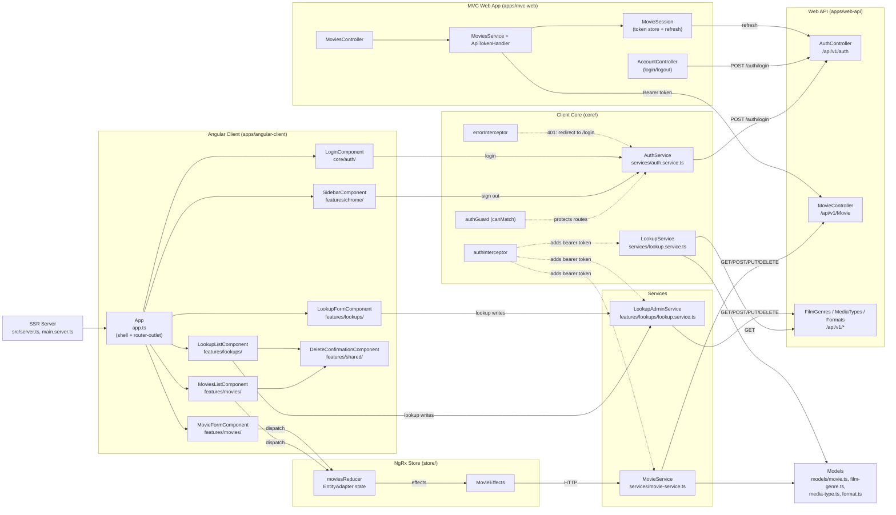

# Architecture & Diagram

This document contains the project's architecture diagram and instructions to render it.

## System Shape

Three applications in one monorepo, all talking to a single Web API.

| App | Stack | Role |
| --- | --- | --- |
| `apps/angular-client` | Angular 22 + NgRx 22, standalone + SSR | Primary client. Tokens in `sessionStorage`, bearer token added by an interceptor. |
| `apps/mvc-web` | ASP.NET Core MVC on .NET 10 | Server-rendered client. Tokens in the server session, cookie auth for the browser. |
| `apps/web-api` | ASP.NET Core Web API on .NET 10, Clean Architecture | Single source of truth. Domain -> Data -> Api. |

```
Angular client --+
                 +--> Web API (/api/v1) --> EF Core --> SQLite
MVC web app -----+
```

### The API contract, as implemented

The API's movie controller is named `MovieController`, so the route is the
**singular** `/api/v1/Movie`. `/api/v1/movies` returns **404**. This was
verified against a running instance, not inferred from the source.

| Property | Value |
| --- | --- |
| Base path | `/api/v1` |
| Movie routes | `/api/v1/Movie`, `/api/v1/Movie/{id:guid}` |
| Lookup routes | `/api/v1/filmGenres`, `/api/v1/mediaTypes`, `/api/v1/formats` (anonymous reads) |
| Auth routes | `/api/v1/auth/register`, `/login`, `/refresh`, `/logout`, `/me` |
| JSON casing | **camelCase** (`id`, `title`, `releaseYear`, `favourite`, ...) |
| Identifiers | GUIDs |
| List response | Paged envelope: `{ items, pageNumber, pageSize, totalCount, totalPages, hasPrevious, hasNext }` |
| Query keys | `search`, `genre`, `mediaType`, `format`, `sortBy` (`title` or `year`), `sortDir` (`asc` or `desc`), `pageNumber`, `pageSize` |
| Auth header | `Authorization: Bearer <token>` required on all movie endpoints |

Query-string keys are matched case-insensitively, so both `?pageNumber=1` and
`?PageNumber=1` bind. Request and response bodies are camelCase.

> **Watch list.** The original brief calls for a watch list. It is not
> implemented anywhere - no domain model, endpoint, store slice, or component.
> See "Known gaps" in [PROJECT-STATUS.md](PROJECT-STATUS.md).

## Security Architecture

The MoviesApp implements comprehensive security measures following OWASP Top 10 API Security guidelines:

### Web API Security Stack

- **Authentication:** JWT-based with refresh token rotation
- **Authorization:** Role-based (Admin, User) with object-level ownership validation
- **Rate Limiting:** 100 req/min (read), 10 req/min (write)
- **Audit Logging:** All mutations logged with user context
- **Security Headers:** CSP, HSTS, X-Frame-Options, etc.
- **Input Validation:** DTOs with validation attributes
- **Resource Protection:** GUID-based IDs to prevent enumeration

### Authentication Flow

```
Client -> POST /api/v1/auth/login -> JWT Token + Refresh Token
Client -> API Request with Authorization: Bearer <token> -> Validate -> Process
Client -> Token Expired -> Refresh Token -> New JWT Token
```

Access tokens live 15 minutes; refresh tokens live 7 days and are single-use.
Refresh tokens are bound to the access token's `jti`, so a refresh token
presented with a token from a different family is rejected.

**How each client stores the session:**

| Client | Storage | Refresh |
| --- | --- | --- |
| Angular | `sessionStorage` (`moviesapp.accessToken`, `moviesapp.refreshToken`) | Not yet wired - `AuthService.refresh()` exists but nothing calls it, and no interceptor retries a 401. Sessions therefore end after 15 minutes until the user signs in again. |
| MVC | Server-side session (`MovieSession`) | Automatic - `MovieSession.GetAccessTokenAsync` refreshes the token shortly before it expires. |

### Authorization Layers

1. **Authentication Layer:** All endpoints require valid JWT token
2. **Policy Layer:** UserOnly/AdminOnly policies
3. **Object Level:** Ownership validation (users can only access their own resources)
4. **Property Level:** Separate DTOs for create/update operations

### Middleware Pipeline Order

The order matters and is set in `apps/web-api/MoviesApi/Program.cs`:

```
SecurityHeaders → ExceptionHandling → RateLimiting → AuditLogging
  → CORS → HttpsRedirection → Authentication → Authorization → Endpoints
```

> `AuditLoggingMiddleware` is registered **before** `UseAuthentication`, so
> `context.User` is still an unauthenticated principal when it reads the
> name-identifier claim. Its own audit branch is therefore effectively dead;
> the controllers emit the audit rows that are actually stored. Moving the
> middleware after `UseAuthentication` would enable it.

See [SECURITY-OVERVIEW.md](SECURITY-OVERVIEW.md) for the full security posture
and [docs/SECURITY-INCIDENT-2026-09-14.md](SECURITY-INCIDENT-2026-09-14.md)
for the incident that motivated the current controls.

---

## Application Architecture

Mermaid source: [`docs/moviesapp-diagram.mmd`](moviesapp-diagram.mmd)



Render instructions

- Option A — render locally with Mermaid CLI (recommended for PNG/SVG output):

```bash
# Install (optional global)
npm install -g @mermaid-js/mermaid-cli

# Render to SVG
mmdc -i docs/moviesapp-diagram.mmd -o docs/moviesapp-diagram.svg
```

- Option B — use npx (no global install):

```bash
npx @mermaid-js/mermaid-cli -i docs/moviesapp-diagram.mmd -o docs/moviesapp-diagram.svg
```

Notes

- The Mermaid block above is also viewable in many editors that support Mermaid previews (VS Code Mermaid Preview, Obsidian, GitHub with mermaid enabled).
